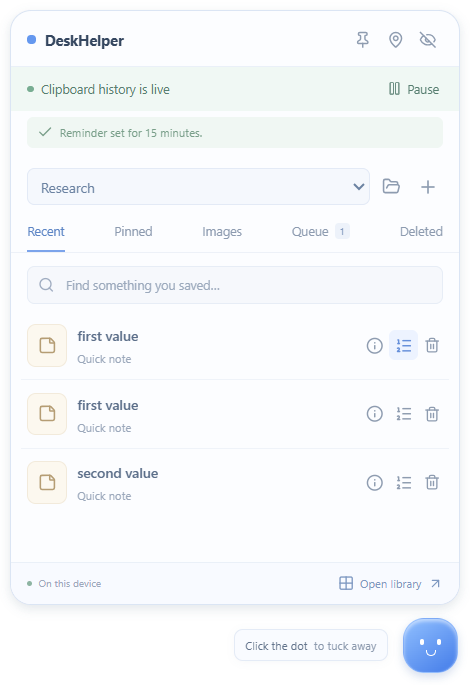

# DeskHelper

**A little desktop pocket for the useful things you copy.**

[](https://github.com/PranavP2207/Desk-Helper/actions/workflows/ci.yml)

DeskHelper is a Windows desktop helper that rests as a small floating dot. Hover or use a shortcut to open your clipboard history, notes, screenshots, and task pockets; copy what you need and tuck it away again.

**Current version: 0.3.0 · Development build · Run from source · No installer yet**

<p align="center">
  
</p>

*Preview uses synthetic demo data. The larger library is optional; the corner pocket is the everyday interface.*

[Features](#features) · [Get started](#get-started) · [Shortcuts](#shortcuts) · [Privacy](#privacy-and-storage) · [Contributing](#contributing) · [Help](#help-and-maintainer)

## Features

| Feature | What it helps you do |
| --- | --- |
| Automatic clipboard history | Keep copied text, links, and images, with search, pinning, duplicate suppression, and pause/resume. |
| Copy and tuck away | Click an item to copy it and immediately collapse the pocket. |
| Image drag-out | Drag a saved screenshot into an app that accepts file drops. |
| Paste queue | Arrange values, copy the next one, and paste it into your form. |
| Task pockets | Group related notes, links, and images under Research, Application, or your own task. |
| Item reminders | Resurface a saved item at a chosen time, with its content attached. |
| Text cleanup | Copy plain text, trim whitespace, change case, or remove duplicate lines. |
| Recently deleted | Restore manually deleted items for seven days. |
| Quick notes and retention | Jot something down; keep it for a day, a week, or until you delete it. |
| Corner and cursor access | Choose your screen/corner or temporarily summon the pocket beside your mouse. |

### Why use it alongside Win + V?

Windows already provides [clipboard history, pinning, and optional cross-device sync](https://support.microsoft.com/en-us/windows/apps/using-the-clipboard). DeskHelper adds task organization, a copy queue, reminders, text cleanup, notes, and recovery in one compact workspace. It keeps up to 1,000 active items with selectable retention.

Win + V remains convenient for basic pasting. DeskHelper is useful for research, applications, and repeated workflows; it requires a running background app and currently has no cross-device sync.

## Get started

You need **Windows**, **Git**, and **Node.js 24 with npm**. There is no account, API key, database server, or cloud service to configure.

```powershell
git clone https://github.com/PranavP2207/Desk-Helper.git
cd Desk-Helper
npm ci
npm start
```

`npm ci` installs the locked dependencies and Electron runtime. `npm start` builds and launches the app. A small dot appears near the bottom-right corner; the library does not open at startup.

After the first successful build, double-click **[Start DeskHelper.cmd](Start%20DeskHelper.cmd)** for a quick launch without rebuilding.

### Your first minute

1. Hover over the dot or press **Ctrl + Shift + Space**.
2. Copy some text or a screenshot made with Print Screen/Snipping Tool. It appears automatically once placed on the clipboard.
3. Click an item to copy and collapse, then paste in your destination app.
4. Open **ⓘ Details** for pinning, task assignment, reminders, and cleanup. Use the numbered-list button to add an item to **Queue**.
5. Use the folder button to manage task pockets, **Deleted** to recover items, and **Pause** to stop clipboard collection.

Close or hide the pocket to keep it in the system tray. Use the tray menu's **Quit DeskHelper** to fully exit. Read the [usage guide](docs/usage.md) for the full workflow.

## Shortcuts

| Shortcut | Action |
| --- | --- |
| Ctrl + Shift + Space | Open or tuck away the corner pocket |
| Ctrl + Alt + Space | Summon beside the cursor; collapse to return to the saved corner |
| Ctrl + Alt + V | Copy and advance the next queued value; then Ctrl + V to paste |
| Ctrl + K / Ctrl + F | Search inside DeskHelper |
| Ctrl + N | Start a quick note |
| Ctrl + Enter | Save the current draft |
| Escape | Back out of details/settings, then tuck away |

Global shortcuts register when available. Position settings show conflicts and button alternatives. DeskHelper never injects paste keystrokes into another app.

## Privacy and storage

- App content stays local. No accounts, analytics, or content uploads.
- Clipboard collection runs while DeskHelper is open and history is live. **Pause/Resume** persists across restarts.
- Saved text and image files are **unencrypted**. Pause before copying sensitive information.
- Checkout data lives in `.local-data/user/`, which is excluded from Git. Back up the whole folder to preserve text, images, and placement.
- Built-in screenshot capture is intentionally absent. Use Windows screenshot tools; DeskHelper collects images from the clipboard.

History does not import old Win+V entries and may miss changes shorter than its 750 ms polling interval. Reminders notify while the app runs and resurface overdue items on reopening. Image drag/drop depends on the receiving app. Expired items are permanently removed; seven-day recovery applies to manual deletion.

See [usage and storage details](docs/usage.md), [known limitations](known-issues.md), and the [security policy](.github/SECURITY.md).

## Development

Built with **Electron, React, TypeScript, and Vite**, with a validated local JSON store and separate PNG image files.

```powershell
npm run dev           # renderer development with hot reload
npm run check         # 31 logic/storage checks, strict types, production build
npm run test:desktop  # 7 isolated Electron desktop scenarios; interactive Windows required
```

Tests use a private clipboard and generated images. They do not read or write your real clipboard. Windows CI runs the logic tests, type checks, and build; native GUI tests run locally. See the [development guide](docs/development.md).

```text
.
├── .github/       Community guidance, issue/PR templates, and CI
├── core/          Shared models, storage, clipboard watcher, and geometry
├── docs/          Usage, development, brainstorming, and demo images
├── electron/      Native windows, tray, clipboard, and isolated preload bridge
├── scripts/       Build, development, launch, and smoke-check helpers
├── src/           React corner pocket and optional library
└── tests/         Logic/storage tests and desktop scenarios
```

The four root context files—[current state](current-state.md), [decisions](decisions.md), [instructions](instructions.md), and [known issues](known-issues.md)—record project scope and verified behavior.

## Contributing

Bug reports, documentation improvements, accessibility feedback, and focused pull requests are welcome. Please read the [contribution guide](.github/CONTRIBUTING.md) and [community guidelines](.github/CODE_OF_CONDUCT.md). Use fabricated data in examples and screenshots.

For a larger feature, [open a feature request](https://github.com/PranavP2207/Desk-Helper/issues/new?template=feature_request.yml) first. The original [brainstorming notes](docs/brainstorm.md) contain ideas, not release commitments.

## Roadmap

- [ ] Windows installer and migration from checkout data
- [ ] Code signing and an update strategy
- [ ] Startup-at-login preference
- [ ] More multi-monitor and external-app integration validation
- [ ] Optional mascot animation

No delivery dates are promised. Existing capabilities and validation are documented in [current-state.md](current-state.md).

## Help and maintainer

Maintained by [PranavP2207](https://github.com/PranavP2207). For help, read [SUPPORT.md](.github/SUPPORT.md), [report a bug](https://github.com/PranavP2207/Desk-Helper/issues/new?template=bug_report.yml), or browse [existing issues](https://github.com/PranavP2207/Desk-Helper/issues). Follow the security policy for sensitive reports.

## License

**Currently unlicensed**, by the owner's choice. No LICENSE file or open-source license grant is included. Licensing will be decided separately before an open-source release. Package metadata is marked `UNLICENSED`.
